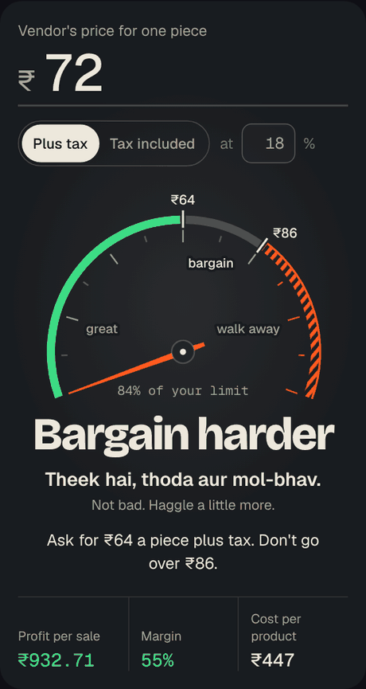
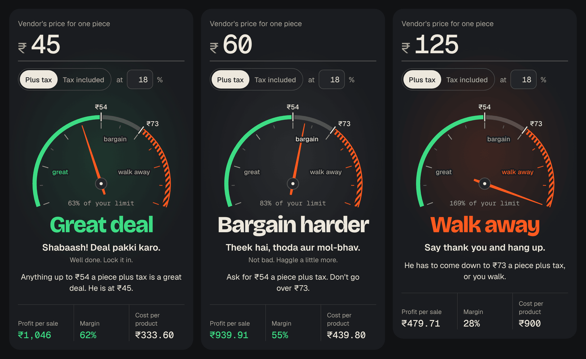

# Mol-Bhav Meter

**A vendor says a price. You get one word back: great deal, bargain, or walk away.**

[**Try it live**](https://GITHUB_USERNAME.github.io/mol-bhav-meter/) on any phone. Free, no sign-up, works with no signal.

[](https://github.com/GITHUB_USERNAME/mol-bhav-meter/actions/workflows/ship.yml)
[](LICENSE)

<p align="center">
  
</p>

Mol-bhav (मोल-भाव) is Hindi for haggling. In Delhi, where I'm from, it's a sport. The problem is that nobody does the math while they're playing.

## Why I built it

The first version was for my dad. He's on the phone with a vendor. The vendor says "60 a piece, GST extra, 300 for delivery." Dad has about four seconds to say yes, push back, or hang up.

The right answer depends on six other numbers: what the product sells for, how many pieces go into one set, sales tax, payment fees, shipping and the box. Nobody carries that in their head on a call.

So I put all of it behind one number you type and one dial you read. The dial is a rev counter, because I'm a car guy and a redline is the clearest "stop" ever designed.

- **Needle in the green:** book it.
- **Needle in the grey:** you have room. The meter gives you the exact price to ask for.
- **Needle past the redline:** say thank you and hang up.



## What it does

- **One number in, one word out.** Type the quote, read the verdict. No "Calculate" button.
- **Tells you what to say next.** "Ask for ₹54 a piece plus tax. Don't go over ₹73." In the vendor's own terms, so you never convert in your head.
- **Counts what vendors leave out.** Tax you can't claim back, delivery spread across the order, and the leftover pieces that don't fill a set.
- **Shares the whole deal in a link.** Your partner opens it and sees the same numbers. There's a WhatsApp summary too.
- **Works with no signal.** Open it once and it's saved on your phone. Markets and warehouses have terrible reception.
- **Keeps your numbers yours.** Nothing you type leaves your phone. No account, no ads, no tracking.
- **Six currencies.** ₹, C$, US$, £, € and AED.

## The math in 30 seconds

```
walk-away cost = your price ÷ (1 + sales tax) × (1 − profit target) − fees − shipping − packing
great deal     = 75% of the walk-away cost, or less
```

A brass diya set of 6, sold at ₹1,999, with a 50% profit target:

| Step | ₹ |
| --- | ---: |
| Customer pays | 1,999.00 |
| ÷ 1.18, sales after tax | 1,694.07 |
| × 50%, what's left after your profit | 847.03 |
| − fees at 4.72% | − 94.35 |
| − shipping | − 100.00 |
| − packing | − 120.00 |
| **Walk-away cost for the set** | **532.68** |
| **Great deal for the set** | **399.51** |

The vendor says ₹60 plus 18% tax, ₹300 delivery on 120 pieces. That's ₹73.30 a piece landed and ₹439.80 for the set. Over the great line, under the walk-away line. Verdict: **bargain harder**, and ask for ₹54.

The long version, with all four tax cases, is in [docs/THE-MATH.md](docs/THE-MATH.md).

## Run it yourself

You need [Node.js](https://nodejs.org) 22 or newer.

```bash
git clone https://github.com/GITHUB_USERNAME/mol-bhav-meter.git
cd mol-bhav-meter
npm install
npm run dev     # the app, live-reloading, at http://localhost:5173
npm test        # 53 tests in about a second
npm run build   # the finished site, in dist/
```

## How it's built

| Piece | Job | Why this one |
| --- | --- | --- |
| TypeScript | The language | It catches "you passed a word where a number goes" before the app runs |
| Vite | Builds the site | One command, about 150 ms |
| Vitest | Runs the tests | 53 checks on the math, the wording and the links |
| No framework | The screen | One screen doesn't need React. The whole app is about 6 kB of JavaScript once compressed |
| Service worker | Offline | Saves the app on the phone the first time it opens |
| GitHub Actions | Test, then deploy | Every push runs the tests. If one fails, nothing ships |
| GitHub Pages | Hosting | Free |

The map:

```
src/
  core/            the brain: no screen, no browser, just numbers
    meter.ts       the deal math. Start here.
    deal.ts        turns a deal into a link and back
    words.ts       every sentence the meter says
    format.ts      money on screen
    *.test.ts      the tests, next to the code they check
  ui/dial.ts       draws the rev counter
  main.ts          wires the form to the brain and the brain to the screen
  styles/brand.css the dakshdua.ca colours, in one file
public/sw.js       the offline worker
scripts/stamp-sw.mjs  stamps each build with a version
.github/workflows/ship.yml  test, then deploy
```

Want the guided tour? [docs/CTO-NOTES.md](docs/CTO-NOTES.md) explains every idea in here in plain English, how to debug it, and five small changes to try.

## What I got wrong first

- **Vendor tax.** Version one counted the tax on the vendor's bill as a cost for everybody. That's right for a shop that isn't tax-registered yet, and wrong the day the registration comes through. The same ₹60 quote flips from "bargain" to "great deal". It's one checkbox now, with a test on each side.
- **A link that lied by a hair.** A 9.975% tax rate went into a share link and came back as 9.975000000000001%. Computers count in binary and sometimes it shows. A test caught it before a person did.
- **A dial that rounded the bad news.** The needle stops at 150%, so a quote at 169% of your limit used to read "150%". The needle still stops there. The number under it tells the truth now.

## How this was built

I build with Claude as my pair programmer. I bring the problem and decide what the thing should do. Claude writes most of the code. I review it until I can explain every file, and [the CTO notes](docs/CTO-NOTES.md) are my study guide, in public. Every commit carries the co-author line, so the history is honest about who typed what.

## What's next

- [ ] Hindi interface
- [ ] Save vendors and compare their quotes side by side
- [ ] Import mode: customs duty and currency conversion
- [ ] A light theme for bright sun

Ideas and pull requests are welcome. If you sell something and the meter gets your numbers wrong, [open an issue](https://github.com/GITHUB_USERNAME/mol-bhav-meter/issues) with the deal link. That's the fastest way to get it fixed.

## License

[MIT](LICENSE). Use it, fork it, put it inside your own shop's tools.

Built in Calgary by [Daksh Dua](https://dakshdua.ca).
